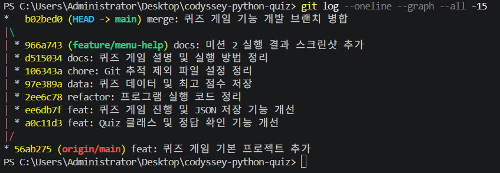
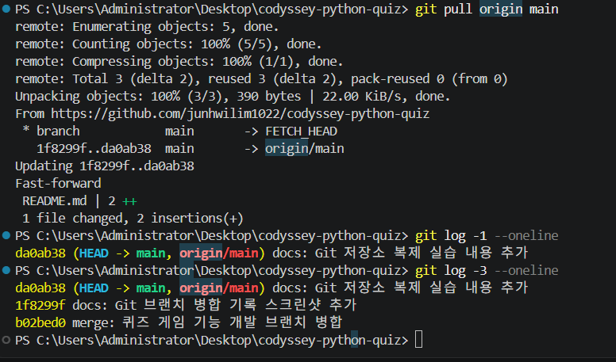

# Python 기초 퀴즈 게임

## 1. 프로젝트 소개

Python으로 만든 콘솔 퀴즈 게임이다.

메뉴에서 원하는 기능을 선택해 퀴즈를 풀거나 새로운 문제를 추가할 수 있다. 퀴즈 목록과 최고 점수도 확인할 수 있다.

프로그램을 종료해도 추가한 문제와 최고 점수가 사라지지 않도록 JSON 파일을 사용했다.

## 2. 퀴즈 주제

퀴즈 주제는 Python 기초 문법으로 정했다.

Python을 공부하면서 배운 내용을 복습할 수 있는 프로그램을 만들고 싶었다. 기본적인 함수, 자료형, 조건문, 반복문 등에 관한 문제를 넣었다.

처음 실행하면 기본 퀴즈 6개가 제공되고, 원하는 문제를 직접 추가할 수도 있다.

## 3. 개발 환경

- Python 3.10 이상
- Visual Studio Code
- Git / GitHub
- Windows 11

외부 라이브러리는 사용하지 않고 Python 표준 라이브러리만 사용했다.

## 4. 실행 방법

1. GitHub 저장소를 다운로드하거나 clone한다.
2. VS Code에서 프로젝트 폴더를 연다.
3. 터미널에서 아래 명령어를 입력한다.

```powershell
python main.py
```

프로그램을 실행하면 다음 메뉴가 나온다.

```text
======================================
         Python 기초 퀴즈 게임
======================================
1. 퀴즈 풀기
2. 퀴즈 추가
3. 퀴즈 목록
4. 점수 확인
5. 종료
======================================
메뉴 선택 (1~5):
```

## 5. 주요 기능

### 퀴즈 풀기
- 저장된 퀴즈를 순서대로 풀 수 있음.
- 각 문제에는 4개의 선택지가 있음.
- 정답을 입력하면 정답과 오답 여부를 알려줌.
- 모든 문제를 풀면 최종 점수를 보여줌.

### 퀴즈 추가
- 새로운 문제와 선택지 4개를 입력할 수 있다.
- 정답 번호는 1~4 중에서 선택.
- 추가한 문제는 state.json에 저장.

### 퀴즈 목록
- 현재 등록된 퀴즈를 확인할 수 있다.
- 새로 추가한 퀴즈도 목록에 표시된다.

### 점수 확인
- 퀴즈를 풀고 받은 최고 점수를 확인할 수 있다.
- 기존 최고 점수보다 높은 점수를 받으면 기록이 갱신.

### 예외 처리
- 메뉴에 없는 번호를 입력하면 다시 입력하도록 안내함.
- 숫자가 아닌 값이나 빈 입력도 처리함.
- Ctrl+C나 입력 종료 상황에서도 안전하게 종료하도록 처리함.
- 저장 파일이 없거나 손상된 경우 기본 퀴즈를 불러옴.

## 6. 파일 구조

```text
codyssey-python-quiz/
├── main.py
├── quiz.py
├── quiz_game.py
├── state.json
├── README.md
├── .gitignore
└── docs/
    └── screenshots/
        ├── 01_environment.png
        ├── 02_menu.png
        ├── 03_add_quiz.png
        ├── 04_quiz_list.png
        ├── 05_play.png
        ├── 06_score.png
        ├── 07_restart.png
        ├── 08_git_history.png
        ├── 09_clone_pull.png
        └── 10_github_repo.png
```

### 파일별 역할

- `main.py` : 프로그램 시작
- `quiz.py` : Quiz 클래스, 문제와 정답 관리
- `quiz_game.py` : QuizGame 클래스, 메뉴와 게임 진행 및 저장 기능 관리
- `state.json` : 퀴즈 데이터와 최고 점수 저장
- `README.md` : 프로젝트 설명
- `.gitignore` : Git에서 제외할 파일 설정
- `docs/screenshots/` : 실행 결과와 Git 작업 화면

## 7. 데이터 저장

퀴즈 데이터는 프로젝트 폴더의 `state.json`에 UTF-8 형식으로 저장.

JSON 파일에는 다음 정보가 들어감.

- `quizzes` : 등록된 퀴즈 목록
- `question` : 문제 내용
- `choices` : 선택지 4개
- `answer` : 정답 번호
- `best_score` : 최고 점수

프로그램을 다시 실행하면 저장된 데이터를 불러옴.

파일이 없거나 정상적으로 읽을 수 없는 경우에는 기본 퀴즈로 시작하도록 만듬.

## 8. Git 작업

Git으로 프로젝트의 변경사항을 기록.

기능별로 커밋을 나누고 `feature/menu-help` 브랜치에서 작업한 내용을 `main` 브랜치에 병합.

GitHub 저장소를 별도 폴더에 clone한 뒤 README를 수정하고 push. 이후 원래 프로젝트에서 pull을 실행해 변경사항이 반영되는 것도 확인.

## 9. 실행 화면

프로그램을 실행하면서 주요 기능과 Git 작업 화면을 캡처했다.

### 메뉴 화면


### 퀴즈 추가


### 퀴즈 목록


### 퀴즈 풀기


### 최고 점수


### 재실행 후 데이터 유지


### Git 브랜치 및 커밋 기록


### Git pull 실습


그 외 개발 환경과 GitHub 저장소 화면도 `docs/screenshots` 폴더에 정리했다.
