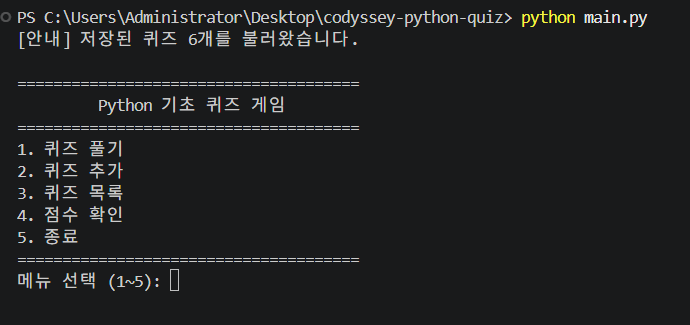
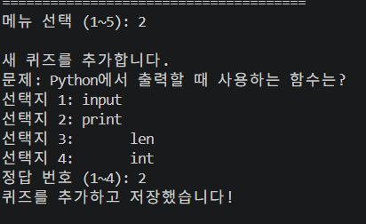
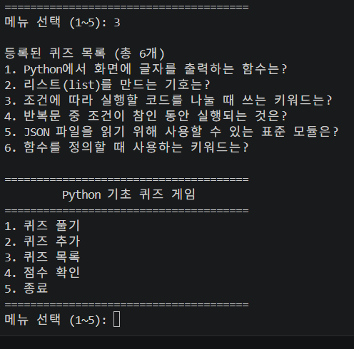
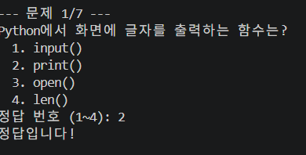
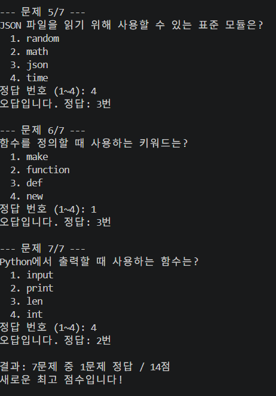
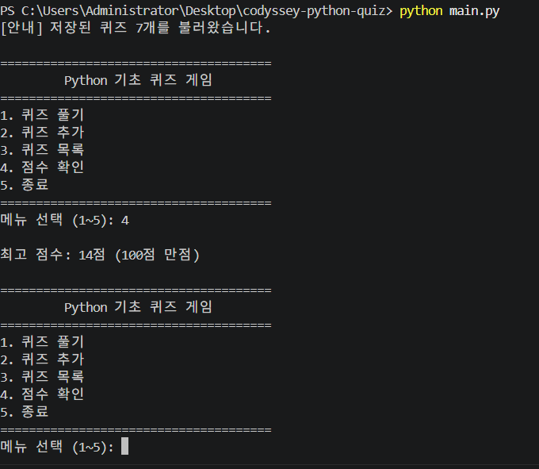

# Python 기초 퀴즈 게임

## 1. 프로젝트 소개

Python으로 만든 콘솔 퀴즈 게임이다.

메뉴에서 원하는 기능을 선택해 퀴즈를 풀거나 새로운 문제를 추가할 수 있다. 퀴즈 목록과 최고 점수도 확인할 수 있다.

프로그램을 종료해도 추가한 문제와 최고 점수가 사라지지 않도록 JSON 파일을 사용했다.

## 2. 퀴즈 주제

퀴즈 주제는 Python 기초 문법으로 정했다.

Python을 공부하면서 배운 내용을 복습할 수 있는 프로그램을 만들고 싶었다. 기본적인 함수, 자료형, 조건문, 반복문 등에 관한 문제를 넣었다.

처음 실행하면 기본 퀴즈 6개가 제공되고, 원하는 문제를 직접 추가할 수도 있다.

## 3. 개발 환경

- Python 3.10 이상
- Visual Studio Code
- Git / GitHub
- Windows 11

외부 라이브러리는 사용하지 않고 Python 표준 라이브러리만 사용했다.

## 4. 실행 방법

1. GitHub 저장소를 다운로드하거나 clone한다.
2. VS Code에서 프로젝트 폴더를 연다.
3. 터미널에서 아래 명령어를 입력한다.

```powershell
python main.py
```

프로그램을 실행하면 다음 메뉴가 나온다.

```text
======================================
         Python 기초 퀴즈 게임
======================================
1. 퀴즈 풀기
2. 퀴즈 추가
3. 퀴즈 목록
4. 점수 확인
5. 종료
======================================
메뉴 선택 (1~5):
```

## 5. 주요 기능

### 퀴즈 풀기
- 저장된 퀴즈를 순서대로 풀 수 있음.
- 각 문제에는 4개의 선택지가 있음.
- 정답을 입력하면 정답과 오답 여부를 알려줌.
- 모든 문제를 풀면 최종 점수를 보여줌.

### 퀴즈 추가
- 새로운 문제와 선택지 4개를 입력할 수 있다.
- 정답 번호는 1~4 중에서 선택.
- 추가한 문제는 state.json에 저장.

### 퀴즈 목록
- 현재 등록된 퀴즈를 확인할 수 있다.
- 새로 추가한 퀴즈도 목록에 표시된다.

### 점수 확인
- 퀴즈를 풀고 받은 최고 점수를 확인할 수 있다.
- 기존 최고 점수보다 높은 점수를 받으면 기록이 갱신.

### 예외 처리
- 메뉴에 없는 번호를 입력하면 다시 입력하도록 안내함.
- 숫자가 아닌 값이나 빈 입력도 처리함.
- Ctrl+C나 입력 종료 상황에서도 안전하게 종료하도록 처리함.
- 저장 파일이 없거나 손상된 경우 기본 퀴즈를 불러옴.

## 6. 파일 구조

```text
codyssey-python-quiz/
├── main.py
├── quiz.py
├── quiz_game.py
├── state.json
├── README.md
├── .gitignore
└── docs/
    └── screenshots/
        ├── 01_environment.png
        ├── 02_menu.png
        ├── 03_add_quiz.png
        ├── 04_quiz_list.png
        ├── 05_play.png
        ├── 06_score.png
        ├── 07_restart.png
        ├── 08_git_history.png
        ├── 09_clone_pull.png
        └── 10_github_repo.png
```

### 파일별 역할

- `main.py` : 프로그램 시작
- `quiz.py` : Quiz 클래스, 문제와 정답 관리
- `quiz_game.py` : QuizGame 클래스, 메뉴와 게임 진행 및 저장 기능 관리
- `state.json` : 퀴즈 데이터와 최고 점수 저장
- `README.md` : 프로젝트 설명
- `.gitignore` : Git에서 제외할 파일 설정
- `docs/screenshots/` : 실행 결과와 Git 작업 화면

## 7. 데이터 저장

퀴즈 데이터는 프로젝트 폴더의 `state.json`에 UTF-8 형식으로 저장.

JSON 파일에는 다음 정보가 들어감.

- `quizzes` : 등록된 퀴즈 목록
- `question` : 문제 내용
- `choices` : 선택지 4개
- `answer` : 정답 번호
- `best_score` : 최고 점수

프로그램을 다시 실행하면 저장된 데이터를 불러옴.

파일이 없거나 정상적으로 읽을 수 없는 경우에는 기본 퀴즈로 시작하도록 만듬.

## 8. Git 작업

Git으로 프로젝트의 변경사항을 기록.

기능별로 커밋을 나누고 `feature/menu-help` 브랜치에서 작업한 내용을 `main` 브랜치에 병합.

GitHub 저장소를 별도 폴더에 clone한 뒤 README를 수정하고 push. 이후 원래 프로젝트에서 pull을 실행해 변경사항이 반영되는 것도 확인.

## 9. 실행 화면

프로그램을 실행하면서 주요 기능과 Git 작업 화면을 캡처했다.

### 메뉴 화면


### 퀴즈 추가


### 퀴즈 목록


### 퀴즈 풀기


### 최고 점수


### 재실행 후 데이터 유지


### Git 브랜치 및 커밋 기록


### Git pull 실습


그 외 개발 환경과 GitHub 저장소 화면도 `docs/screenshots` 폴더에 정리했다.

## 10. 코드 구조와 설계 이유

### 입력 검증과 데이터 저장을 나눈 이유

사용자가 입력하는 값과 JSON 파일을 읽고 저장하는 작업은 역할이 다르기 때문에 따로 나눴다.

`read_number()`는 숫자와 입력 범위를 확인하고, `read_nonempty()`는 빈 문자열을 입력하지 못하게 한다.

반면 `load_state()`와 `save_state()`는 파일에서 데이터를 불러오거나 저장하는 역할을 한다.

이렇게 나누면 입력 방식이나 저장 방식을 바꿀 때 관련된 부분만 수정하기 편하다.

### 클래스를 사용한 이유

퀴즈 문제와 게임 진행 기능을 구분하려고 `Quiz`와 `QuizGame` 클래스를 사용했다.

`Quiz`는 문제, 선택지, 정답을 관리하고 `QuizGame`은 퀴즈 목록, 최고 점수, 메뉴 실행, 데이터 저장 등을 담당한다.

함수만 따로 사용하는 것보다 관련 데이터와 기능을 묶어서 관리하기 편하고, 게임이 진행되는 동안 퀴즈 목록과 최고 점수도 객체에 유지할 수 있다.

## 11. Git 작업 규칙

### 커밋 메시지

작업 내용을 쉽게 확인할 수 있도록 커밋 메시지 앞에 종류를 붙였다.

- `feat:` 새로운 기능 추가
- `fix:` 오류 수정
- `docs:` README나 문서 수정
- `refactor:` 기존 코드 구조 정리
- `chore:` 설정 파일 등 기타 작업

예를 들어 퀴즈 기능을 추가하면 `feat: 퀴즈 추가 기능 구현`, README를 수정하면 `docs: README 설명 보완`처럼 작성한다.

제목은 한 줄로 간단하게 적고, 어떤 작업을 했는지 알 수 있도록 작성한다. 기능별로 커밋을 나눠서 변경 기록을 확인하기 쉽게 했다.

### 브랜치 사용

기본 브랜치는 `main`으로 사용하고, 기능을 수정할 때는 별도의 `feature/` 브랜치를 만들어 작업했다.

실제로 `feature/menu-help` 브랜치에서 작업한 뒤 `main`에 병합했다.

기능별로 작업 공간을 나누면 수정 중인 내용이 기본 브랜치에 바로 반영되지 않고, 작업을 마친 뒤 병합할 수 있다는 장점이 있다.

## 12. JSON 데이터 구조

데이터는 `state.json`에 저장한다.

전체 데이터를 하나의 객체로 묶고, 그 안에 `quizzes`와 `best_score`를 넣었다.

`quizzes`를 배열로 만든 이유는 여러 문제를 순서대로 저장하기 위해서다. 각 문제에는 `question`, `choices`, `answer`를 넣어 문제 내용, 선택지, 정답을 하나로 묶었다.

`best_score`는 문제 목록과 별도로 저장했다. 문제 데이터와 게임 기록은 서로 다른 정보이기 때문이다.

### JSON 방식의 한계

지금은 퀴즈 수가 많지 않아 JSON 파일만으로도 데이터를 관리할 수 있다.

하지만 문제가 많아지면 파일 전체를 읽고 다시 저장해야 해서 속도가 느려질 수 있고, 불러온 데이터를 메모리에 보관해야 하는 부담도 커진다.

데이터가 많이 늘어나거나 여러 사람이 동시에 사용하는 프로그램으로 확장한다면 SQLite 같은 데이터베이스를 사용하는 방법을 생각할 수 있다.

## 13. 데이터 백업과 복구

현재 프로그램은 `state.json` 파일이 없거나 손상되면 기본 퀴즈로 시작한다.

다만 이 기능은 이전 데이터를 복원하는 자동 백업 기능은 아니다.

추가한 퀴즈와 점수를 보관하려면 프로그램을 종료한 상태에서 `state.json`을 `state_backup.json`이라는 이름으로 따로 복사해 두면 된다.

PowerShell에서 다음 명령어로 백업할 수 있다.

`Copy-Item state.json state_backup.json`

이후 원본 파일에 문제가 생기면 프로그램을 실행하기 전에 백업 파일을 복사해서 복원할 수 있다.

`Copy-Item state_backup.json state.json`

백업 파일 자체가 정상적인 데이터인지 확인해야 하고, 프로그램이 실행 중일 때는 복원하지 않는 것이 좋다.

현재는 수동 백업 방식이며, 자동 백업 기능은 구현하지 않았다.

## 14. 기능 수정 시 확인할 부분

기능을 변경할 때 어떤 파일과 메서드를 수정해야 하는지 정리했다.

- 퀴즈 문제와 정답 구조 변경: `quiz.py`의 `Quiz`, `check_answer()`, `to_dict()`, `from_dict()`
- JSON 저장 형식 변경: `quiz_game.py`의 `load_state()`, `save_state()`
- 사용자 입력 방식 변경: `read_number()`, `read_nonempty()`
- 퀴즈 진행 방식 변경: `play()`
- 새로운 문제 추가 기능 변경: `add_quiz()`
- 퀴즈 목록이나 점수 표시 변경: `show_quizzes()`, `show_score()`
- 메뉴 추가 및 변경: `run()`
- 기본 퀴즈 변경: `default_quizzes()`

기능을 수정한 뒤에는 게임 실행뿐 아니라 잘못된 입력 처리, JSON 저장, 프로그램 재실행 후 데이터 유지도 확인해야 한다.
